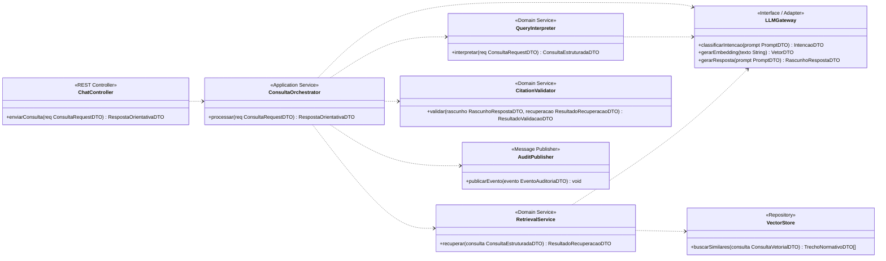

# Dossiê de Arquitetura Viva — Pipeline RAG e Geração de Respostas com IA

**Projeto:** Assistente de IA para Exportação (Sistema Fiep)
**Trabalho individual 1:** Processamento inteligente da consulta
**Requisitos relacionados:** RF01, RF04, RF10 e RF11
**Autor:** Igor Natã Trancoso de Aguiar

---

## 1. Escopo da funcionalidade

Quando o usuário pergunta em linguagem natural (ex.: *"quero exportar peças automotivas para a Argentina, quais documentos preciso?"*), o sistema precisa:

1. **Interpretar** a consulta e reformulá-la em termos técnicos (**RF01**).
2. **Recuperar** trechos normativos relevantes e responder sobre requisitos de exportação (**RF04**).
3. **Citar a fonte oficial** de cada orientação relevante (**RF10**).
4. **Declarar incerteza** quando faltar dado, fundamento ou validação, em vez de apresentar hipótese como certeza (**RF11**).

Esse conjunto é o "motor" do assistente: um pipeline **RAG** (*Retrieval-Augmented Generation*), em que o modelo de linguagem só redige a resposta a partir de trechos normativos recuperados e rastreáveis.

### Vínculo com a Visão de Domínio

| Abstração do domínio | Papel neste pipeline |
|---|---|
| Consulta em Linguagem Natural | Entrada (`ConsultaRequestDTO`) e entidade com ciclo de vida (Artefato 3) |
| Intenção do Usuário | Resultado da classificação (`IntencaoDTO`) |
| Operação de Exportação | Contexto extraído: produto, NCM, destino (`ConsultaEstruturadaDTO`) |
| Fonte Normativa | Origem e vigência de cada trecho recuperado (`TrechoNormativoDTO.fonteId`) |
| Regra de Aplicabilidade | Filtros por NCM, país e vigência na recuperação |
| Resposta Orientativa | Saída final (`RespostaOrientativaDTO`) |

### Pressupostos

- A pilha tecnológica (React, FastAPI, PostgreSQL 16 + pgvector, RabbitMQ, Redis) é a **proposta** deste dossiê. Ajuste se a equipe já definiu outra.
- O histórico da sessão (RF02) está fora do escopo. O front-end envia um `contextoResumido` já pronto no `ConsultaRequestDTO`.
- A ingestão e atualização das normas (RF12) é tratada apenas como container no C4, sem detalhamento comportamental.
- Valores numéricos (limiar de similaridade, top-k, timeout, tentativas) são **iniciais** e devem ser calibrados com testes.

---

## 2. Contrato de operações públicas (base da Regra de Consistência)

Toda mensagem do Artefato 1 corresponde a uma operação pública declarada abaixo.

### DTOs

| DTO | Campos principais |
|---|---|
| `ConsultaRequestDTO` | `sessaoId`, `texto`, `contextoResumido`, `idioma` |
| `IntencaoDTO` | `tipo` (DOCUMENTOS, PROIBICAO, EXIGENCIA_PAIS, REGRA_ADUANEIRA, PROCEDIMENTO), `confianca` |
| `ConsultaEstruturadaDTO` | `consultaId`, `intencao`, `produto`, `ncmSugerida`, `paisDestino`, `subconsultasTecnicas[]`, `dadosFaltantes[]` |
| `VetorDTO` | `valores[]`, `dimensao` |
| `ConsultaVetorialDTO` | `vetor`, `filtroNcm`, `filtroPais`, `dataReferencia`, `topK` |
| `TrechoNormativoDTO` | `trechoId`, `texto`, `fonteId`, `score`, `vigenteEm` |
| `ResultadoRecuperacaoDTO` | `trechos[]`, `maxScore` |
| `PromptDTO` | `instrucoesSistema`, `contexto`, `pergunta` |
| `CitacaoDTO` | `trechoId`, `fonteId` |
| `RascunhoRespostaDTO` | `texto`, `citacoes[]`, `tokensUsados` |
| `ResultadoValidacaoDTO` | `citacoesValidas`, `problemas[]` |
| `RespostaOrientativaDTO` | `consultaId`, `tipo` (ORIENTACAO_FUNDAMENTADA, SOLICITACAO_DADOS, INCERTEZA, ERRO_SERVICO), `texto`, `fontes[]`, `dadosSolicitados[]` |
| `EventoAuditoriaDTO` | `consultaId`, `tipoEvento`, `timestamp`, `metadados` |

## 8. Rastreabilidade e renderização

| Requisito | Onde é atendido |
|---|---|
| RF01 — Consulta em linguagem natural | Seq.: `interpretar`, `classificarIntencao`; Atividades: reformulação; Estados: `Interpretando` |
| RF04 — Respostas sobre requisitos | Seq.: `recuperar`, `gerarResposta`; Atividades: fork/join de recuperação; Estados: `Recuperando`, `Gerando` |
| RF10 — Citação das fontes | Seq.: `validar`; Atividades: validação de citações; Estados: `Validando`; ADR 0001 |
| RF11 — Indicação de incerteza | Seq.: ramos `SOLICITACAO_DADOS` e `INCERTEZA`; Estados: `AguardandoDados`, `RespondidaComIncerteza` |

**Como renderizar**
- Blocos `mermaid` renderizam direto no GitHub.
- Blocos `plantuml` (Artefatos 2 e 4): Usar o Workspace com os links
